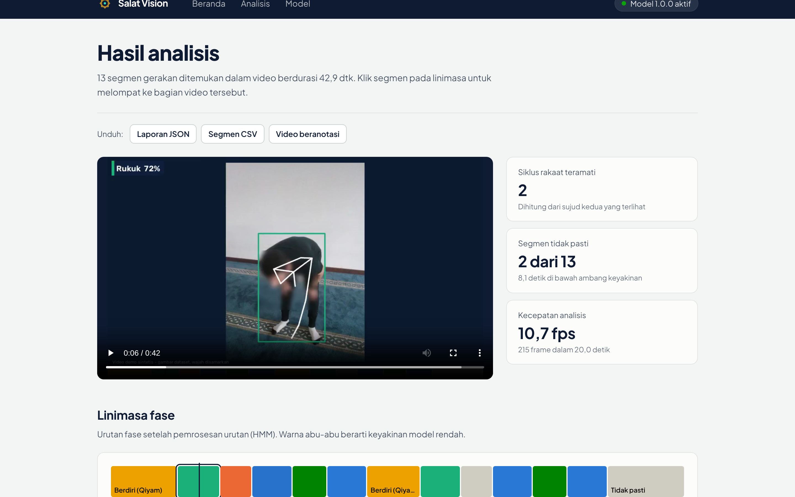

# Salat Vision — prayer-posture recognition from images and video

Salat Vision recognises the **visible postures of Islamic prayer** in photos and videos and turns a recording into a
timeline of prayer phases — *Berdiri, Rukuk, Iktidal, Sujud, Duduk di antara dua sujud, Tasyahud* — with timestamps,
durations and an honest confidence/uncertainty flag. It runs fully locally (FastAPI + ONNX Runtime + MediaPipe on CPU)
behind an Indonesian-language React web app.

> It recognises body postures that a camera can see. It does **not** judge whether a prayer is religiously valid.



## Highlights (all numbers measured in this repository)

| | |
|---|---|
| Data actually provided | 41 images, 40 annotated people, 4 posture classes, **29 independent capture groups** |
| Evaluation protocol | 3 × repeated **stratified group** 5-fold CV, nested hyper-parameter search, cluster-bootstrap 95% CIs |
| Models compared | 11 (baseline, training-free pose rules, 4 pose-feature classifiers, 2 frozen-CNN probes, 2 fine-tuned CNNs, fusion) |
| Selected model | pre-registered **fusion** of a pose-feature logistic regression and a frozen MobileNetV3 probe |
| Macro-F1 (annotated crops) | **0.80** [0.68–0.90] (majority baseline 0.14) |
| Macro-F1 (whole images, automatic localisation) | **0.68** [0.53–0.86] |
| Temporal decoder | grammar-constrained HMM + local context rules; segment F1@50 **71** vs 26 for raw per-frame labels (conservative semi-synthetic benchmark) |
| Speed | **84 ms per frame** (11.9 frames/s) on a 4-vCPU Xeon, no GPU; ONNX embedder 2.3× faster than PyTorch |
| Tests | 55 Python tests, 12 frontend unit tests, 5 Playwright end-to-end tests against the real backend — all passing |

## What is in the box

```
configs/            default.yaml (all paths + hyper-parameters), session_groups.yaml (leakage review)
src/salat_vision/   data (extraction, VOC, audit, splits) · features (pose, embeddings) · models (CNN, classical, rules)
                    evaluation (metrics, CIs, calibration) · inference (detector, predictor, temporal HMM, video) · export
backend/app/        FastAPI service (jobs, validation, CORS, cleanup)          frontend/   React + TS + Vite + Tailwind app
scripts/            extract → audit → download models → run experiments → train final → benchmarks → figures → demo
notebooks/          01 audit · 02 training · 03 evaluation · 04 video inference (executed, with real outputs)
models/             salat_vision_v1/ exported bundle (ONNX + scikit-learn + manifest with SHA-256)
artifacts/          metrics (JSON/CSV), figures, reports                       docs/       architecture, cards, methodology…
portfolio/          technical report (PDF), slide deck (PPTX), reusable assets + chart source data
tests/              pytest suite (unit, inference, API)
```

## Quick start

Requirements: Python 3.10–3.13 (3.12 used), Node 22, ffmpeg optional (bundled via `imageio-ffmpeg`), Linux/macOS.
On minimal Linux images MediaPipe needs `libegl1 libgles2 libgl1`.

```bash
python3.12 -m venv .venv && source .venv/bin/activate
pip install --index-url https://download.pytorch.org/whl/cpu torch==2.15.0 torchvision==0.29.2
pip install -r requirements/dev.txt && pip install -e .
```

```bash
python scripts/extract_dataset.py --zip /path/to/Salat-Postures-Dataset-main.zip   # safe extraction to data/raw/
python scripts/download_models.py                                                  # MediaPipe + torchvision weights
```

The trained bundle is already in `models/salat_vision_v1`, so you can run the app straight away:

```bash
uvicorn backend.app.main:app --port 8000
```

```bash
cd frontend && cp .env.example .env.local && npm ci && npm run dev    # http://localhost:5173
```

Or with Docker (not built in the authoring environment — no Docker daemon was available there):

```bash
docker compose up --build    # API :8000, web app :8080
```

## Reproduce every result

```bash
python scripts/audit_dataset.py          # tables, figures, artifacts/reports/dataset_audit.md, data/splits/
python scripts/run_experiments.py        # 11 models × 15 folds (~12 min on 4 CPU cores; --skip-finetune ≈ 3 min)
python scripts/train_final.py            # selected pipeline on all data → models/salat_vision_v1 (bit-for-bit reproducible)
python scripts/benchmark.py              # CPU latency + pose-model variants
python scripts/benchmark_temporal.py --select   # decoder selection (validation seed) + benchmark (test seed)
python scripts/make_demo_video.py        # synthetic, face-blurred demo clip (git-ignored)
python scripts/make_figures.py           # all evaluation figures + portfolio assets with source data
python scripts/build_notebooks.py --execute
```

Random seeds are fixed (`project.seed: 42`); folds are saved in `data/splits/cv_splits.json`.

## How it works

1. **Find the person** — EfficientDet-Lite0 (COCO "person"); fallback to the pose-landmark box, then the full frame.
2. **Two posture models on the crop** — MediaPipe Pose (33 landmarks) → 19 view-tolerant geometric features → logistic
   regression; and a frozen MobileNetV3-Large (ONNX) embedding → logistic regression. Late fusion averages them
   (image model alone when no pose is found).
3. **Temporal decoding** — a 7-state HMM following the prayer order segments the score sequence (Viterbi), then local
   context rules name the phases: standing after bowing = *Iktidal*, sitting between two prostrations vs. after the
   second = *Tasyahud*. Segments whose mean score is below 0.55 are flagged *Tidak pasti* (uncertain).

See [docs/architecture.md](docs/architecture.md) and [docs/methodology.md](docs/methodology.md).

## API

| Method | Path | Purpose |
|---|---|---|
| GET | `/health` | liveness + whether the model bundle loaded |
| GET | `/model-info` | classes, phases, pipeline, CV metrics, comparison table, benchmarks, limitations |
| POST | `/predict/image` | one photo → posture, scores, person box, 33 landmarks, timings |
| POST | `/predict/video` | synchronous video analysis (short clips, scripts) |
| POST | `/jobs/video` | asynchronous analysis with real progress (`?annotate=true&sample_fps=5`) |
| GET | `/jobs/{id}` · `/jobs/{id}/video` · `/jobs/{id}/report?format=json\|csv` | status/result, annotated MP4, downloads |
| DELETE | `/jobs/{id}` | delete a result and its files immediately |
| GET | `/docs` | interactive OpenAPI documentation |

Uploads are size-limited (10 MB images, 150 MB videos), type-checked by magic bytes, streamed to a private temp folder
and deleted after analysis; results expire after 30 minutes. Without a model bundle the predict endpoints return
**503** with the reason — never a fabricated prediction.

## Testing

```bash
pytest -q                                   # 55 tests (unit, real-model inference, API incl. job lifecycle)
cd frontend && npm test                     # 12 Vitest tests
VITE_API_BASE_URL=http://127.0.0.1:8000 npm run build && npm run e2e   # 5 Playwright tests vs. the real backend
```

Results of the last run are recorded in [docs/test_report.md](docs/test_report.md).

## Limitations

* **Tiny data.** The provided archive is the public *sample* of the Salat Postures Dataset (the full 1,904-image release
  is on Kaggle and was not available here). 40 people / 29 independent groups give wide confidence intervals; rankings
  between the top models are suggestive, not conclusive.
* **Six phases from four postures.** Iktidal and the two sittings are inferred from order, not seen.
* **No real prayer videos.** The temporal decoder is evaluated on semi-synthetic sequences built from real held-out
  scores; the demo clip is assembled from training images and is not an accuracy measurement.
* **Prostration is hardest for pose estimation** (pose found on 67% of prostration crops vs. 100% of sitting crops).
* **Scores are not calibrated** (they are under-confident: ECE 0.18).
* Generalisation to other cameras, clothing, lighting, children or groups is untested.

## Troubleshooting

| Symptom | Fix |
|---|---|
| `OSError: libEGL.so.1` when MediaPipe loads | `apt-get install libegl1 libgles2 libgl1` |
| `/health` shows `model_loaded: false` | run `scripts/download_models.py`; the message names the missing/changed file |
| Browser shows "Server tidak terhubung" | start uvicorn; check `VITE_API_BASE_URL` and `SALAT_API_ALLOWED_ORIGINS` |
| Camera button missing | the page must be served from `localhost` or HTTPS for camera access |
| WebM from the browser has no duration | handled: frames are resampled by FFmpeg, not counted from metadata |

## References and licences

* Koubâa, A., Ammar, A., Benjdira, B., Al-Hadid, A., Kawaf, B., Al-Yahri, S. A., Babiker, A., Assaf, K., Ras, M. B. (2020).
  *Activity Monitoring of Islamic Prayer (Salat) Postures using Deep Learning.* 6th Conference on Data Science and
  Machine Learning Applications (CDMA), pp. 106–111. IEEE. arXiv:1911.04102. Dataset: github.com/riotu-lab/Salat-Postures-Dataset.
* MediaPipe Pose Landmarker / Object Detector / Face Detector — Google, Apache-2.0.
* Howard et al. (2019) *Searching for MobileNetV3*; He et al. (2016) *Deep Residual Learning* — torchvision weights, BSD-3-Clause.
* Lea et al. (2017) *Temporal Convolutional Networks for Action Segmentation* — segmental edit score and F1@k.
* Code: MIT (see `LICENSE`). Dataset images are not redistributed; no dataset licence file was included in the archive.
