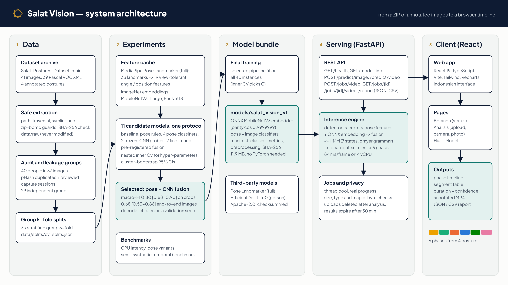
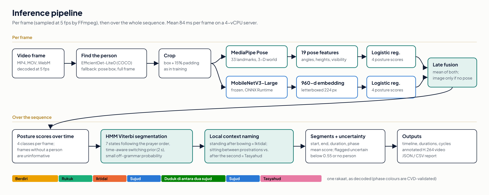

# Architecture

Editable sources: `portfolio/assets/diagrams/system_architecture.svg` (vector) and `.mmd` (Mermaid).

## Components

| Layer | Code | Responsibility |
|---|---|---|
| Configuration | `configs/default.yaml`, `src/salat_vision/config.py` | one source of paths and hyper-parameters; env-var overrides (`SALAT_*`) |
| Data | `salat_vision.data.extract / voc / dataset / audit / splits` | safe ZIP extraction, Pascal VOC (+ polygon) parsing, quality audit, pHash + reviewed-session grouping, stratified group k-fold |
| Features | `salat_vision.features.pose / pose_features`, `models.cnn` | MediaPipe Pose wrapper, 19 view-tolerant features with missing indicators, letterboxed ImageNet embeddings |
| Models | `salat_vision.models.classical / rules / cnn` | scikit-learn pipelines with nested CV, a-priori geometric rules, fine-tuning loop with early stopping/checkpoints, late fusion |
| Experiments | `salat_vision.experiments`, `scripts/run_experiments.py` | one protocol for 11 models on two views (annotated crops, whole images) |
| Export | `salat_vision.export`, `scripts/train_final.py` | fit selected pipeline on all data, ONNX export with parity check, manifest with SHA-256 |
| Inference | `salat_vision.inference.bundle / predictor / temporal / video` | checksum-verified loading, per-frame prediction, HMM decoding, FFmpeg decode/encode, annotated video |
| API | `backend/app/*` | FastAPI app factory, upload validation, thread-pool jobs with progress, TTL cleanup, CORS |
| Web | `frontend/src/*` | React 19 + TS; pages Beranda, Analisis, Hasil, Model; Recharts; camera via MediaRecorder |

## Request flow (video)

1. Browser `POST /jobs/video` (XHR with upload progress) → the API streams the file to a private temp folder,
   enforcing the size limit while streaming, then checks magic bytes (MP4/MOV, Matroska/WebM, AVI).
2. A worker thread (one `PosturePredictor` per thread, because MediaPipe graphs are not thread-safe) decodes frames
   with FFmpeg at `sample_fps`, predicts each frame and reports progress (`frames_done / frames_expected`).
3. The temporal decoder converts frame scores into segments; an annotated H.264 video is rendered (optional).
4. The upload is deleted in a `finally` block. The result and annotated video live in memory/temp storage until the
   job expires (30 min) or the client calls `DELETE /jobs/{id}`.
5. The browser polls `GET /jobs/{id}` and navigates to `/hasil/{id}` when done.

## Inference pipeline

## Design decisions

* **No PyTorch at serving time.** The CNN is exported to ONNX (cosine parity ≥ 0.9999 with PyTorch is enforced at
  export); the API image only needs ONNX Runtime + MediaPipe + scikit-learn. ONNX Runtime is 2.3× faster here.
* **Checksums before deserialisation.** `ModelBundle.verify()` checks every file's SHA-256 against the manifest before
  `joblib.load` touches it (joblib/pickle must never load untrusted bytes).
* **Fail honestly.** A missing or tampered bundle makes `/health` report `model_loaded: false` and prediction routes
  return 503 with the reason.
* **Async jobs instead of long requests.** Real progress, cancellation by TTL/DELETE, bounded queue (429 when full).
* **Same preprocessing everywhere.** Crop padding, letterbox fill, normalisation and feature definitions live in one
  place and are recorded in the manifest.
