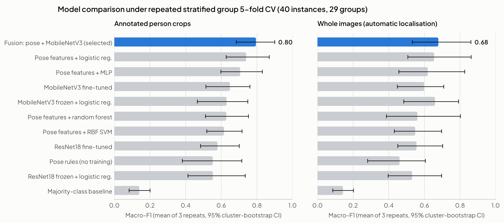
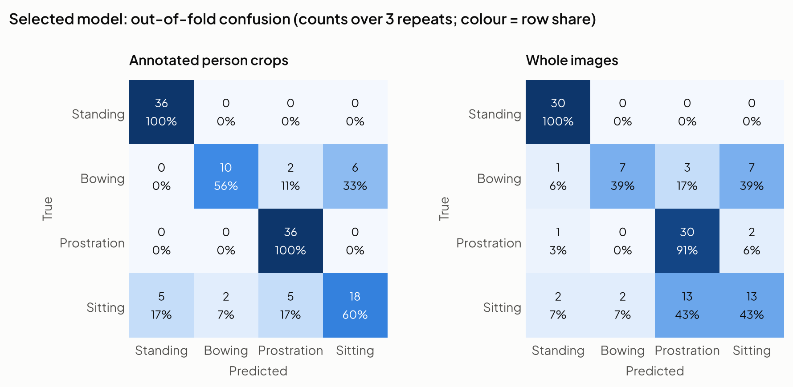
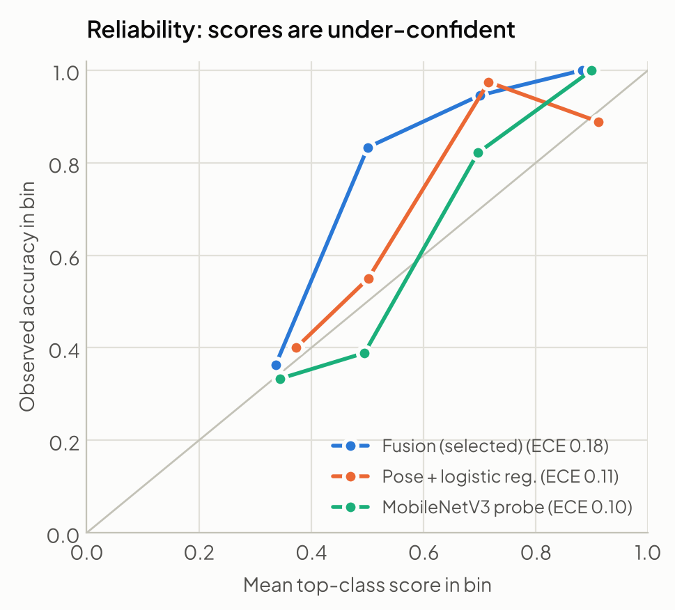

# Experiment report

Generated artefacts: `artifacts/metrics/{cv_results.json, model_comparison.csv, oof_predictions.csv,
training_histories.json, localization_eval.csv, runtime_benchmark.json, pose_variant_benchmark.json,
temporal_benchmark.json, temporal_decoder_selection.json}`; figures in `artifacts/figures/`.

Environment: Python 3.12.3, PyTorch 2.15.0 (CPU), torchvision 0.29.2, MediaPipe 1.2.3, scikit-learn 1.9.1,
ONNX Runtime 1.32.0; Intel Xeon 2.1 GHz, 4 vCPU, no GPU. Seed 42. Full CV run: 720 s.

## 1. Model comparison (macro-F1, mean of 3 repeats ± SD, 95% cluster-bootstrap CI)

| Model | Crops | 95% CI | Whole images | 95% CI | ECE |
|---|---|---|---|---|---|
| **Fusion: pose LR + MobileNetV3 probe (selected)** | **0.795 ± 0.024** | 0.68–0.90 | **0.679** | 0.53–0.86 | 0.18 |
| Pose features + logistic regression | 0.740 ± 0.040 | 0.63–0.87 | 0.655 | 0.51–0.86 | 0.11 |
| Pose features + MLP | 0.706 ± 0.053 | 0.60–0.83 | 0.619 | 0.46–0.83 | 0.14 |
| MobileNetV3 fine-tuned | 0.649 ± 0.075 | 0.51–0.76 | 0.599 | 0.45–0.71 | 0.09 |
| MobileNetV3 frozen + logistic regression | 0.630 ± 0.036 | 0.47–0.75 | 0.660 | 0.48–0.79 | 0.10 |
| Pose features + random forest | 0.629 ± 0.069 | 0.51–0.75 | 0.561 | 0.39–0.80 | 0.05 |
| Pose features + RBF SVM | 0.616 ± 0.078 | 0.52–0.72 | 0.549 | 0.43–0.70 | 0.12 |
| ResNet18 fine-tuned | 0.579 ± 0.122 | 0.48–0.70 | 0.556 | 0.45–0.70 | 0.02 |
| Pose rules (training-free; 15% abstain) | 0.553 ± 0.000 | 0.38–0.72 | 0.461 | 0.28–0.61 | 0.20 |
| ResNet18 frozen + logistic regression | 0.553 ± 0.054 | 0.41–0.73 | 0.531 | 0.40–0.70 | 0.09 |
| Majority-class baseline | 0.140 ± 0.009 | 0.08–0.20 | 0.143 | 0.09–0.20 | – |

**Findings**

1. Every learned model beats the baseline by a wide margin; pose geometry alone (no training) reaches 0.55.
2. The pre-registered fusion is best on both views and the most stable across repeats; pose and appearance make
   different mistakes.
3. Fine-tuning does not beat the frozen probe (0.65 vs 0.63, overlapping CIs) while taking ~100× longer to train; the
   training curves show memorisation (training loss → 0.25, validation loss ≈ 1.0).
4. MobileNetV3 beats ResNet18 in all four CNN settings.
5. The ranking of the top models is **not statistically conclusive** (overlapping CIs; 29 groups).

## 2. Selected model in detail

| Class | Precision | Recall | F1 |
|---|---|---|---|
| Standing | 0.88 | 1.00 | 0.94 |
| Bowing | 0.83 | 0.56 | 0.67 |
| Prostration | 0.84 | 1.00 | 0.91 |
| Sitting | 0.75 | 0.60 | 0.67 |

Calibration: under-confident (ECE 0.18).

## 3. Localisation

Person found by the detector in 30/37 images, by the pose fallback in 5, full frame in 2 (a cartoon and a distant
figure); 91.9% of localised boxes overlap an annotated person with IoU ≥ 0.5. End-to-end macro-F1 drops from 0.80 to
0.68, mostly through sitting → prostration confusions on detector crops.

## 4. Pose-model variants

| Variant | Detection rate | Standing | Bowing | Prostration | Sitting | Mean latency |
|---|---|---|---|---|---|---|
| lite | 80.0% | 83% | 67% | 67% | 100% | 29.6 ms |
| **full (selected)** | **85.0%** | 92% | 83% | 67% | 100% | 33.6 ms |
| heavy | 82.5% | 92% | 67% | 67% | 100% | 69.4 ms |

## 5. Runtime (deployed pipeline, per frame)

| Stage | Mean | p95 |
|---|---|---|
| Person localisation | 42.0 ms | 70.9 ms |
| Pose landmarks | 32.3 ms | 42.8 ms |
| Pose classifier | 1.2 ms | 1.9 ms |
| Image model (ONNX) | 8.2 ms | 10.2 ms |
| **Total** | **83.8 ms (11.9 fps)** | 113.3 ms |

Embedder: ONNX Runtime 7.5 ms vs PyTorch 17.0 ms. A 42.9 s clip at 5 fps (215 frames) is analysed in ≈ 20 s (2.1× real time).

## 6. Temporal decoding (300 semi-synthetic sequences per regime, test seed)

| Regime | Decoder | Frame phase acc. | Edit | F1@50 | Segments / true |
|---|---|---|---|---|---|
| segment-consistent (conservative) | raw per frame | 0.704 | 23.8 | 25.6 | 4.32 |
| | smoothing + rules | 0.755 | 68.3 | 66.4 | 1.10 |
| | global HMM | 0.678 | 76.0 | 66.7 | 0.82 |
| | **HMM + local rules (deployed)** | **0.792** | 75.7 | **71.0** | 0.82 |
| independent per frame (optimistic) | raw per frame | 0.715 | 14.8 | 14.7 | 6.57 |
| | smoothing + rules | 0.867 | 80.9 | 80.6 | 1.17 |
| | global HMM | 0.918 | 98.2 | 95.4 | 0.98 |
| | **HMM + local rules (deployed)** | **0.942** | 98.2 | **96.3** | 0.98 |

The global grammar is the best segmenter but can desynchronise phase names after a fully misrecognised segment; the
hybrid keeps the segmentation and names phases locally. Decoder settings were selected on a separate validation seed
(`temporal_decoder_selection.json`).

## 7. Demo clip (pipeline check, not accuracy)

The synthetic 42.9 s clip (13 planned phases, two rakaat) decodes to the planned 13-segment sequence with 96.7% frame
agreement; 2 segments are flagged uncertain. The model has seen these images, so this only verifies the mechanics.

## 8. Reproducibility checks

* The notebook re-run of the fast models reproduced the scripted CV numbers exactly.
* Re-exporting the bundle produced bit-identical files (SHA-256 of ONNX + both classifiers unchanged).
